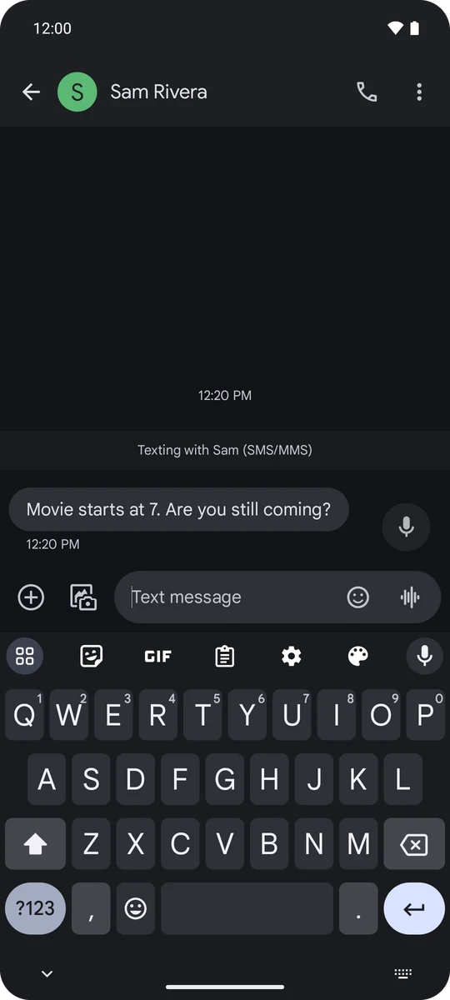
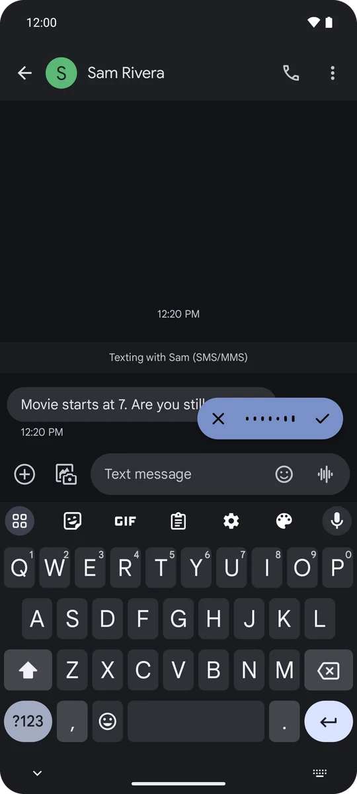
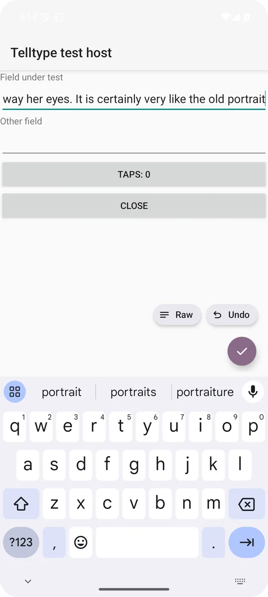
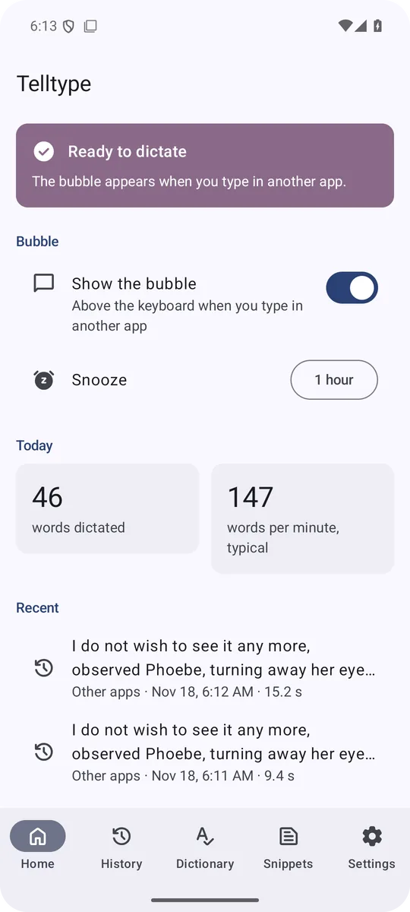
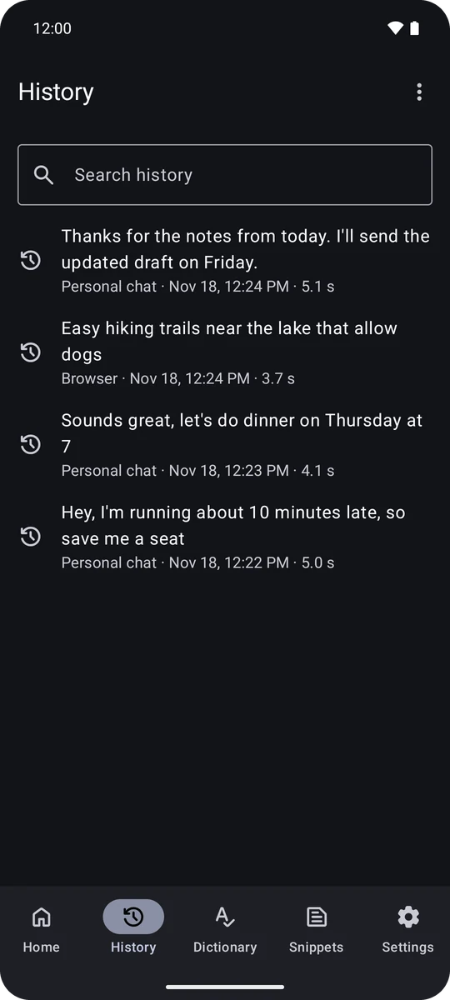
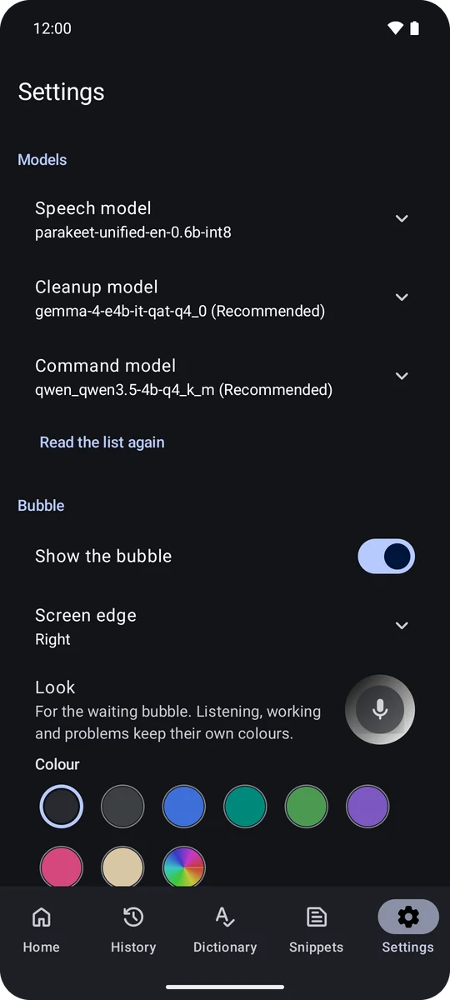
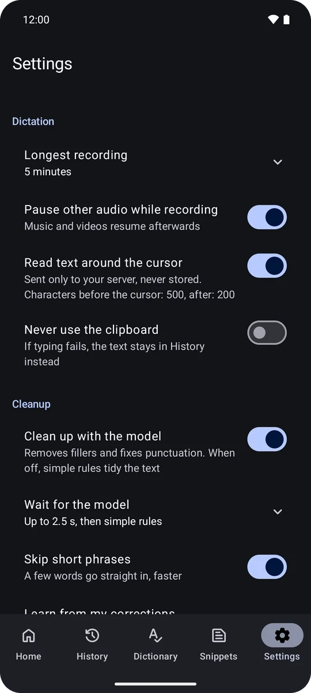
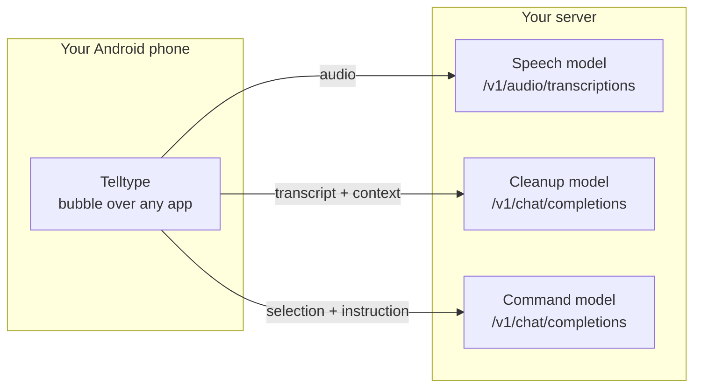

<div align="center">


# Telltype

**Talk the way you talk. Get the text you meant, in any app on your Android phone.**<br>
Free and open source. Speech to text and cleanup run on your own server, and nowhere else.

[](https://github.com/joeglenn/telltype/actions/workflows/android.yml)
[](https://github.com/joeglenn/telltype/actions/workflows/server-rs.yml)

[Download](https://github.com/joeglenn/telltype/releases/latest) ·
[Website](https://joeglenn.github.io/telltype/) ·
[Run the server](server-rs/README.md) ·
[Privacy](PRIVACY.md)

</div>

<p align="center">
  
  &nbsp;
  
  &nbsp;
  
</p>

## What you say → what gets typed

| You say | Telltype types |
|---|---|
| *the the report is uh basically done I just need to um add the charts* | The report is basically done. I just need to add the charts. |
| *let's meet at five pm no actually six pm* | Let's meet at 6 pm. |
| *my appointment is on march third at two thirty* | My appointment is on March 3 at 2:30. |
| *pack the following um charger passport headphones and the blue jacket* | Pack the following:<br>- Charger<br>- Passport<br>- Headphones<br>- The blue jacket |

Real output of Telltype's default cleanup model (Gemma 4 E4B) with the app's own prompt, taken from its test runs.

Telltype is a dictation app for Android, inspired by [Wispr Flow](https://wisprflow.ai): you talk the way you
talk, with ums, restarts and "no wait, six", and what lands in the app is what you meant, written the way you would
write it. A small bubble sits above the keyboard whenever you type. Tap it, speak, tap ✓, and the text is typed at
the cursor of whatever app you are in: no keyboard switch, no copy and paste. The work happens on a server you run:
speech recognition with NVIDIA Parakeet, and a small language model that tidies the transcript. Telltype ships its
own server, [Telltype Server](server-rs/README.md), and also works with any OpenAI-compatible server.

## What you get

- **Talk naturally.** Fillers and false starts are left out, punctuation and capitals are added, and swearing stays
  if you said it. Numbers, times and dates come out as digits, and a spoken list becomes a list.
- **It types what you meant.** "No wait", "I mean" and "scratch that" are followed, not typed. If the model is slow
  or its answer fails a check, simple rules tidy the raw transcript instead. **Raw** swaps in exactly what you said
  and **Undo** removes the text for a few seconds afterwards.
- **It sounds right in every app.** The same words come out as "I am going to be 10 minutes late. Sorry, traffic is
  crazy." in an email and "yeah so i'm gonna be 10 minutes late sorry traffic is crazy" in a chat with a friend.
  Email, work chat, personal chat, notes, AI chat, code and browser each get a tone you choose (formal, casual,
  very casual or as spoken), and you can override the category per app.
- **Your names, spelled right.** A dictionary for names and jargon, with "sounds like" forms: with "Kubernetes" in
  it, "the cooper netties cluster is down again" is typed as "The Kubernetes cluster is down again." Telltype can
  offer to learn a word when you correct it after dictating. **Snippets**: say "my address" and get the saved text.
- **Edit text by voice.** Select text, tap the bubble and say what to do: "make this a bulleted list", "shorter",
  "more polite". "send me the report by friday. i need it for the board meeting." plus "make this more polite"
  became "Could you please send me the report by Friday? I need it for the board meeting." Undo brings the
  original back.
- **Knows where you are.** Up to 500 characters before and 200 after the cursor go to your server with the
  dictation, so names and context come out right. Never stored.
- **Types where you are.** The bubble appears only while a text field has focus and the keyboard is open. If an app
  refuses the text, it goes to the clipboard with a Paste button, and it is always in History.
- **Never loses a word.** A dictation that cannot reach the server is queued and transcribed later. **History** has
  search, swipe right to archive, swipe left to delete (with Undo), and a retention period you set.
- **Skips sensitive fields.** No bubble on password fields, and an exclusion list that starts with common password
  managers and authenticator apps.
- **Diagnostics.** A self-test that sends a bundled clip through the whole pipeline, the time each stage took, and
  a debug bundle that never contains your key.

<p align="center">
  
  &nbsp;
  
  &nbsp;
  
  &nbsp;
  
</p>

## How it works



1. You tap the bubble. Telltype records with the microphone (a foreground service, with Android's microphone
   indicator on) and shows a level meter (and the recording time after 10 seconds).
2. When you finish, the audio goes to your server's speech model. Telltype Server uses Parakeet Unified EN 0.6B
   through sherpa-onnx, on the CPU.
3. The transcript, the tone for the app you are in and the text around the cursor go to the cleanup model
   (Telltype Server's default is Gemma 4 E4B, run by `llama-server`).
4. The result is typed into the field through Android's accessibility service. The recording is deleted.

Measured on a Ryzen AI MAX+ 395 server with a Pixel 10 Pro XL connected over Tailscale: transcribing a 7 s clip takes about
0.15-0.2 s once the model is warm, cleanup typically 0.25-0.4 s, and from the end of speech to typed text
1.0-1.6 s.

## Privacy

Audio and text go only to the server address you enter; Telltype has no analytics, no crash-reporting service, no
advertising id and no account. Recordings are deleted as soon as the text is typed. History stays on the phone for
30 days by default (adjustable, or off; archived entries stay until you delete them), and your server key is stored
encrypted with a key held in the Android Keystore. Details: [PRIVACY.md](PRIVACY.md).

## Requirements

- An Android phone with **Android 13** or newer.
- **A server** the phone can reach: [Telltype Server](server-rs/README.md) on a Linux machine, or any server with
  OpenAI-compatible speech and chat endpoints. Telltype never talks to a cloud service of its own.

## Quick start

**1. Run a server.** Either:

- **Telltype Server** (recommended): one program that serves speech to text, runs the cleanup and command models
  through `llama-server`, generates a certificate and a key, and installs as a systemd user unit. Follow
  [server-rs/README.md](server-rs/README.md): it downloads the models (checking their SHA-256), builds with
  Rust 1.94 or newer and starts the server on port 8170.
- **Any OpenAI-compatible server**, without changes. Telltype needs:
  - `POST /v1/audio/transcriptions` for speech (an OpenAI-style transcription server);
  - `POST /v1/chat/completions` for cleanup and Command Mode, for example llama.cpp's `llama-server`;
  - `GET /v1/models` where available: the app lists the models from it so you can pick one in Settings → Models.
    A speech server without it is checked with a one-second silent transcription instead.

  Speech and text can live at two different addresses (Setup → Advanced → Text model address). A bearer key is
  optional. HTTPS works with a certificate your phone trusts or with a self-signed one you confirm once; plain
  HTTP is allowed only to private network addresses.

**2. Install the app.** Download `telltype-<version>.apk` from the
[latest release](https://github.com/joeglenn/telltype/releases/latest) and check it before installing:

```sh
sha256sum -c telltype-1.0.1.apk.sha256               # the checksum file is attached to the same release
apksigner verify --print-certs telltype-1.0.1.apk    # optional (Android SDK build-tools)
```

Every release is signed with the same key. Its certificate's SHA-256 is
`F0:3A:8C:58:21:AB:27:7A:4C:57:72:3B:C1:F7:40:3A:A7:2F:75:CA:D9:35:F2:66:BD:E2:94:03:0B:92:A8:E9`.

Then open the APK on your phone and allow installing from that source.

**3. Set up.** Open Telltype and follow Setup: enter your server's address (for example `https://192.0.2.10:8170`
or `http://server.example:8000`), the key if your server has one, and confirm the certificate's fingerprint if it
is self-signed (compare it with what `telltype-server fingerprint` prints). Then allow the microphone and
notifications and switch on Telltype's accessibility service. Android may first ask you to allow restricted
settings for an app installed from a file: App info → ⋮ → Allow restricted settings.

Open any app, tap a text field, and tap the bubble.

## Building from source

**Android app** (Kotlin, Jetpack Compose): JDK 17 and the Android SDK (platform 37, build-tools 37.0.0).

```sh
cd android
export ANDROID_HOME=$HOME/Android/Sdk     # or sdk.dir=... in local.properties
./gradlew assembleDebug                   # app/build/outputs/apk/debug/app-debug.apk
./gradlew check                           # lint, ktlint, detekt, unit and screenshot tests
```

**Telltype Server** (Rust 1.94 or newer, Linux x86_64):

```sh
cd server-rs
cargo build --release --locked
scripts/gate.sh                           # fmt, clippy, tests with coverage, cargo deny
```

See [CONTRIBUTING.md](CONTRIBUTING.md) for the full set of checks.

## Licence and credits

Telltype is licensed under the [Apache License 2.0](LICENSE). Copyright 2026 Joe Glenn.

- Telltype is inspired by [Wispr Flow](https://wisprflow.ai), which showed how good dictation can feel. Telltype
  is not affiliated with Wispr.
- Its feature set also draws on [OpenWhispr](https://github.com/OpenWhispr/openwhispr) (MIT License). No
  OpenWhispr code or prompt text is included, and Telltype is not affiliated with it.
- Speech recognition: NVIDIA Parakeet (NVIDIA Open Model License) through
  [sherpa-onnx](https://github.com/k2-fsa/sherpa-onnx). Text models: Gemma 4 and Qwen3.5 (Apache License 2.0), served
  by [llama.cpp](https://github.com/ggml-org/llama.cpp). The server downloads these models; they are not part of
  Telltype.
- Test audio: one LibriSpeech utterance (CC BY 4.0) in debug builds only, and clips generated with the Supertonic 3
  text-to-speech model (OpenRAIL-M). See [NOTICE](NOTICE).

Security issues: please report them privately, see [SECURITY.md](SECURITY.md).
